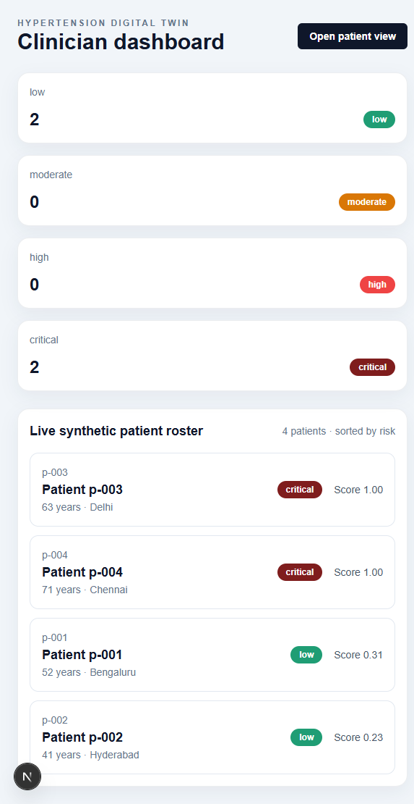
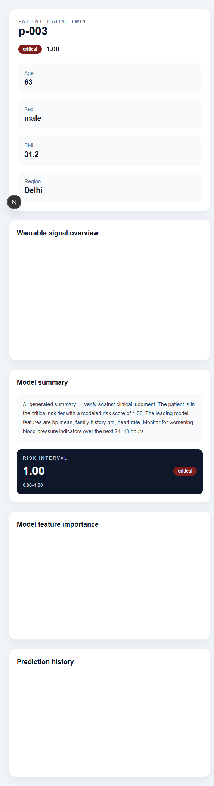
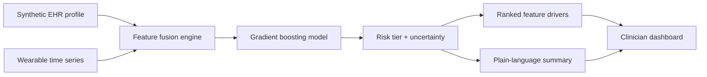

# TwinPulse

### A clinician-first digital twin for earlier hypertension risk review

> **See the signal before it becomes a surprise.**

TwinPulse turns a fragmented stream of synthetic EHR context and wearable signals into one decision-support view: **who needs attention, why the risk changed, and what to review next**.

This is a working proof of concept for a 24–48 hour hypertension-risk horizon. It is designed to make an important healthcare AI idea tangible without hiding the hard parts: data fusion, explainability, uncertainty, privacy boundaries, and a workflow a clinician could actually scan.

> **Prototype boundary:** TwinPulse uses synthetic patient records and reference signal distributions. It is not a diagnostic device, treatment recommendation system, or substitute for clinical judgment.

## At A Glance

| | |
| --- | --- |
| **Primary user** | Clinicians reviewing a small patient population |
| **Prediction horizon** | 24–48 hours |
| **Data** | Synthetic EHR context plus simulated wearable readings |
| **Output** | Risk tier, uncertainty interval, ranked drivers, and review summary |
| **Local stack** | Next.js, FastAPI, scikit-learn, Recharts |

### Quick start

```powershell
# Terminal 1: API
cd backend
.\.venv\Scripts\Activate.ps1
$env:SECRET_KEY = "change-me"
uvicorn app.main:app --reload --port 8000

# Terminal 2: web app
cd frontend
$env:NEXT_PUBLIC_API_URL = "http://localhost:8000"
$env:NEXT_PUBLIC_API_KEY = "change-me"
npm run dev
```

Open [localhost:3000](http://localhost:3000). The API explorer is available at [localhost:8000/docs](http://localhost:8000/docs).

> **Windows note:** Webpack rejects `!` in absolute paths. Because this repository lives in `d:\hyper!`, run the frontend through a temporary drive mapping if `next dev` fails with a webpack path validation error:
>
> ```powershell
> subst H: "d:\hyper!"
> cd H:\frontend
> $env:NEXT_PUBLIC_API_URL = "http://localhost:8000"
> $env:NEXT_PUBLIC_API_KEY = "change-me"
> npm run dev
> ```

## Why This Could Be Shortlisted

Most health AI demos stop at a model score. TwinPulse completes the loop from signal to supervised action:

- **Human-readable workflow:** a clinician starts with a risk board, drills into one patient, and sees the evidence behind the score.
- **Multimodal fusion:** static demographics, diagnoses, labs, medication context, and wearable trends are joined into one digital-twin state.
- **Explainability as a product feature:** top drivers and confidence bounds sit beside the risk tier instead of being buried in a notebook.
- **Responsible by construction:** synthetic data only, explicit uncertainty, API-key protection, restricted CORS, security headers, secret scanning, and a model card.
- **Reproducible engineering:** versioned FastAPI routes, a deterministic training script, automated tests, typed frontend code, CI workflows, and a lockfile.

## The Moment That Matters

The clinical question is not simply *“What is the score?”* It is:

> **“Which patient is drifting toward risk, what changed, and is this worth a proactive review?”**

TwinPulse is built around that question. It compresses noisy longitudinal context into a reviewable signal while keeping the reasoning visible.

## Product Walkthrough

### 1. Scan the population

The dashboard gives a fast operational overview of total patients, risk-tier distribution, recent predictions, and the patients who deserve a closer look.



### 2. Open the digital twin

The patient view combines the current risk state, uncertainty range, wearable trend charts, ranked feature drivers, and a plain-language summary in one review surface.



The screenshots above are generated from the local app using its seeded synthetic roster. They are illustrative product evidence, not clinical outcomes.

### 3. Move from score to action

The demo workflow is intentionally short:

1. Open the dashboard.
2. Select a patient with elevated risk.
3. Review the risk tier and confidence interval.
4. Inspect the top contributing features and wearable trend.
5. Decide whether the patient needs clinician follow-up.

## How It Works



### The model loop

1. A synthetic patient record provides relatively stable context such as age, BMI, diagnoses, medications, labs, and genetic flags.
2. Wearable readings provide dynamic physiology such as heart rate, HRV, sleep, activity, and blood-pressure-proximal signals.
3. The fusion engine produces the same ordered feature schema used by training and inference.
4. A scikit-learn gradient boosting classifier returns a risk probability.
5. The API derives a risk tier, an uncertainty interval, ranked drivers, and a clinician-facing summary.

## Technical Architecture

| Layer | Implementation | Purpose |
| --- | --- | --- |
| Clinician UI | Next.js 15.5, TypeScript, Tailwind, Recharts | Fast dashboard and patient-level review workflow |
| API | Python 3.12, FastAPI, Pydantic | Validated, versioned routes and readiness probes |
| Fusion | Shared feature engineering service | Keeps training and inference schemas aligned |
| Model | scikit-learn gradient boosting | Small, reproducible, auditable PoC model |
| Demo store | In-memory, Postgres-ready pattern | Makes the prototype runnable without cloud credentials |
| Security | API key dependency, CORS policy, CSP, headers, Gitleaks | Demonstrates production-minded controls without overclaiming compliance |
| Delivery | GitHub Actions, npm lockfile, Python test pipeline | Reproducible checks for backend, frontend, and model changes |

## Data and Responsible AI

- No real patient records are used anywhere in the repository.
- The EHR layer is synthetic and reproducible.
- Wearable signal behavior is parameterized around public UCI Cuff-Less Blood Pressure Estimation reference ranges; the source records are not bundled or used for fitting.
- The model exposes uncertainty and feature drivers rather than presenting a bare binary answer.
- The prototype does not diagnose hypertension, recommend medication, or replace a clinician.
- Known limitations and intended future work are documented in [MODEL_CARD.md](MODEL_CARD.md) and [SECURITY.md](SECURITY.md).

## Run It Locally

### Prerequisites

- Python 3.12+
- Node.js 20+
- npm

### Backend

```bash
cd backend
python -m venv .venv

# Windows PowerShell
.venv\Scripts\Activate.ps1

# macOS/Linux
# source .venv/bin/activate

pip install -r requirements.txt
python app/ml/train_model.py
# Use the virtual environment so the saved scikit-learn artifact matches the runtime.
python -m uvicorn app.main:app --reload --host 0.0.0.0 --port 8000
```

The API and Swagger documentation are available at [http://localhost:8000/docs](http://localhost:8000/docs).

### Frontend

In a second terminal:

```bash
cd frontend
npm ci
npm run dev
```

Open [http://localhost:3000](http://localhost:3000).

Copy `frontend/.env.local.example` to `frontend/.env.local` and set the same `SECRET_KEY` value in the backend `.env` before opening the dashboard. The API refuses unauthenticated requests; no secret is embedded in the frontend source. For a local-only demo, the shell variables in the Quick start section are enough.

## API Surface

| Method | Route | Role |
| --- | --- | --- |
| `GET` | `/health` | Liveness probe |
| `GET` | `/health/ready` | Model readiness probe |
| `POST` | `/api/v1/patients` | Create a synthetic patient |
| `POST` | `/api/v1/patients/{id}/wearable-stream` | Ingest wearable readings |
| `GET` | `/api/v1/patients/{id}/twin-state` | Read the current digital-twin state |
| `POST` | `/api/v1/patients/{id}/predict` | Generate risk and explanation |
| `GET` | `/api/v1/patients/{id}/history` | Read prediction history |
| `GET` | `/api/v1/dashboard/summary` | Read population risk summary |

## Validation

The project is checked at each layer:

```bash
# Backend, from an activated backend/.venv
cd backend
pytest -q
ruff check .
mypy app/services app/schemas --ignore-missing-imports

# Frontend
cd ../frontend
npm test
npx tsc --noEmit
npm run lint
npm run build
```

The repository also includes CI workflows for backend tests, frontend checks, model validation, and deployment placeholders under [.github/workflows](.github/workflows).

## Local Demo Checklist

- [x] FastAPI starts with the pinned Python environment.
- [x] Synthetic patients seed automatically at API startup.
- [x] Dashboard loads risk counts and the sorted patient roster.
- [x] Patient view loads wearable trends, risk interval, feature drivers, and prediction history.
- [x] Screenshots in `docs/screenshots/` come from a verified local run.

## What Is Implemented vs. Next

### Implemented in this PoC

- Clinician dashboard and patient digital-twin view
- Synthetic EHR and wearable fusion pipeline
- Reproducible model training script and saved artifact generation
- Versioned FastAPI routes with validation and readiness checks
- Risk tiers, uncertainty ranges, ranked feature drivers, and summaries
- Backend tests, frontend tests, TypeScript, linting, formatting, and production build
- Security headers, API-key dependency, restricted CORS, secret scanning, and documentation
- GitHub Actions workflows and deterministic frontend dependency lockfile

### Deliberate next steps

- Replace the demo store with Supabase/Postgres migrations and audit trails.
- Add clinician identity, role-based access, and session-level authorization.
- Validate on clinically representative, consented data before any real-world use.
- Add calibration, subgroup performance, drift monitoring, and prospective evaluation.
- Connect to real wearable ingestion only after privacy, consent, and reliability requirements are defined.

## Repository Map

```text
backend/
  app/api/v1/       Versioned FastAPI routes
  app/ml/            Synthetic data and model training
  app/services/     Fusion, prediction, scoring, summaries
  tests/             Backend behavior and model tests
frontend/
  app/               Dashboard and patient pages
  lib/               Typed API client
  app/*.test.tsx     Frontend tests
.github/workflows/  CI, model validation, and deployment workflows
MODEL_CARD.md       Model purpose, limits, and evaluation notes
SECURITY.md         Security posture and boundaries
```

## Team and License

TwinPulse is presented as a hackathon-ready healthcare AI prototype by the project team. Add contributor names, roles, and affiliation here for the final submission.

Released under the MIT License.
